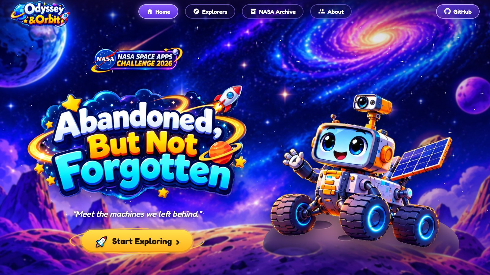
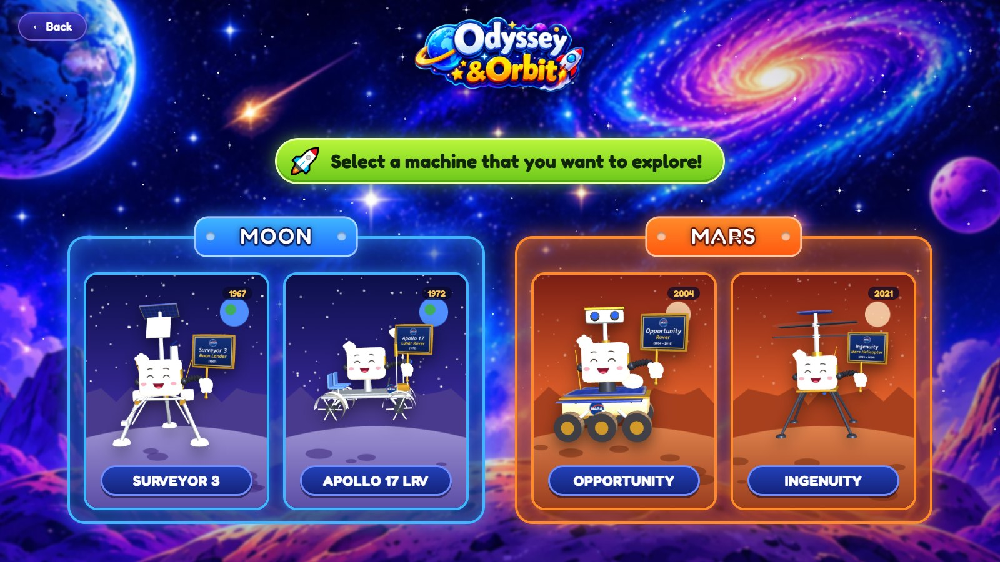
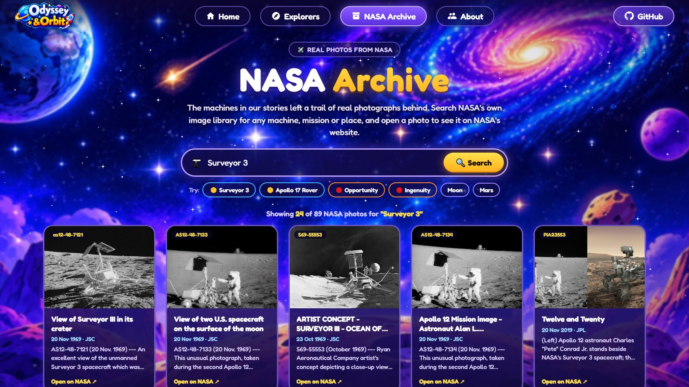
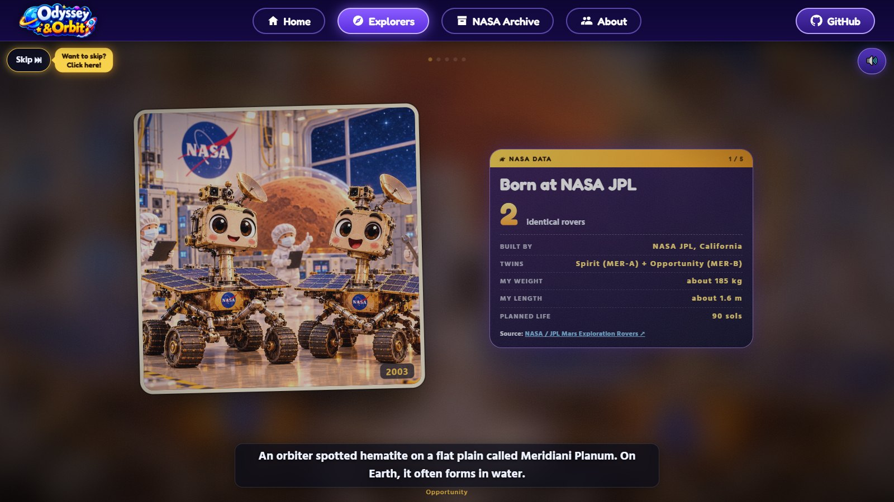
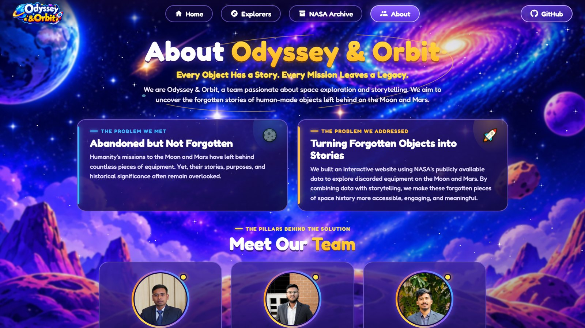

# Odyssey & Orbit: *Abandoned, But Not Forgotten*

**NASA Space Apps Challenge 2026** · Challenge: [Abandoned but not Forgotten: Storytelling about NASA's Discarded Equipment on the Moon and Mars](https://www.spaceappschallenge.org/2026/challenges/nasas-discarded-equipment-storytelling/)

> *Meet the machines we left behind.* An interactive, narrated 3D storytelling website where the machines humanity left on the Moon and Mars tell their own stories, built entirely on NASA's open data.

| | |
|---|---|
| 🌐 **Live website** | *add the Vercel URL here after deploying* |
| 🎬 **Project video** | *add your YouTube link here* |
| 💻 **Source code** | https://github.com/mofasselhossainrana/Odyssey-Orbit |
| 🇧🇩 **Team** | Odyssey & Orbit, Bangladesh |



---

## Table of contents

- [Project overview](#project-overview)
- [Features](#features)
- [Technologies used](#technologies-used)
- [Project structure](#project-structure)
- [Local setup](#local-setup)
- [Running the project](#running-the-project)
- [Deployment](#deployment)
- [Editing the content](#editing-the-content)
- [NASA data and credits](#nasa-data-and-credits)
- [Use of AI](#use-of-ai)
- [Team](#team)
- [License](#license)

---

## Project overview

The 2026 challenge points out that *school-age space enthusiasts often hear only about active, ongoing missions.* When a mission ends, its story gets buried in dense technical reports that most students will never read. Yet those machines have remarkable stories:

- **Surveyor 3** waited alone on the Moon for **31 months**, until Apollo 12 astronauts walked over to visit it.
- **Opportunity** was planned for **90 days** and kept exploring Mars for almost **15 years**.
- **Ingenuity** was planned for **5 flights** and flew **72**.

**Odyssey & Orbit** turns that NASA data into stories kids can feel, without losing accuracy: every fact, photo and date links back to its NASA source.

### The four machines

| World | Machine | Years | Story page |
|---|---|---|---|
| 🌕 Moon | Surveyor 3 | 1967 – 1969 | `stories/surveyor3.html` |
| 🌕 Moon | Apollo 17 Lunar Roving Vehicle | 1972 | `stories/apollo17-lrv.html` |
| 🔴 Mars | Opportunity rover | 2004 – 2018 | `stories/opportunity.html` |
| 🔴 Mars | Ingenuity Mars Helicopter | 2021 – 2024 | `stories/ingenuity.html` |

Story order: Surveyor 3 → Apollo 17 LRV → *"Let's go learn about Mars!"* → Opportunity → Ingenuity → NASA Archive.

## Features

1. **Pick a machine.** Choose a machine on the Moon or on Mars (*Start Exploring* on Home, or **Explorers** in the menu).
2. **Meet the machine.** It comes to life as a friendly 3D character that talks in the first person, with captions on screen.
3. **Flashback.** The story starts in the machine's past. Every key fact sits on a **NASA DATA card** with its source link.
4. **Fly to the real landing site.** A 3D globe takes you to the actual location and touches down on the surface.
5. **Journey map.** A map traces the journey stop by stop. At every stop you unlock a **real NASA photograph** with its credit and a link to it on NASA's website.
6. **Recap and next machine.** Each story ends with a recap, then hands you to the next machine, from the Moon to Mars.
7. **NASA Archive.** A live search of NASA's Image and Video Library (NASA Images API): search any machine, mission or place and open each photo on NASA's website.
8. **Accessible with sound and image.** Every line is spoken *and* shown as a caption, so it works for listeners and readers.
9. **Responsive.** Works on phones, tablets and laptops, with nothing to install.

| Explorers | NASA Archive |
|---|---|
|  |  |
| **A story (Opportunity)** | **About us** |
|  |  |

## Technologies used

The site is plain **HTML, CSS and JavaScript**. There is no framework, no bundler and no `npm install`, and it needs no API keys.

| Technology | Use |
|---|---|
| HTML5 / CSS3 / vanilla JavaScript (ES2017+) | App shell, routing (hash-based: `#/explorers`, `#/story/opportunity`, …), all UI |
| [three.js r128](https://threejs.org) (CDN) | 3D mascots, globes and landing scenes |
| [Web Speech API](https://developer.mozilla.org/en-US/docs/Web/API/Web_Speech_API) | The machines' voices (browser text-to-speech) |
| Canvas 2D | Starfield, card scenes, stylised Moon maps, journey maps |
| [NASA Image and Video Library API](https://images-api.nasa.gov) | Live search on the NASA Archive page (public, no key) |
| [Google Fonts](https://fonts.google.com): Fredoka, Hind Siliguri | Kid-friendly typography; Hind Siliguri for Bangla text |
| Python 3 (development only) | Local web server and the story build scripts in `tools/` |

## Project structure

```
Odyssey-Orbit/
├── index.html                  App shell: navbar, Home, Explorers, NASA Archive, About, story frame
├── stories/                    One self-contained page per machine (loaded in the app's story frame)
│   ├── surveyor3.html            generated by tools/build_stories.py
│   ├── apollo17-lrv.html         generated by tools/build_stories.py
│   ├── opportunity.html
│   └── ingenuity.html
├── assets/
│   ├── css/
│   │   └── main.css            Styles for the app shell (index.html)
│   ├── js/
│   │   ├── app.js              App shell logic: router, Explorers cards, NASA Archive search, story hand-off
│   │   ├── mascots.js          The four 3D cartoon machines (shared by index.html and the Moon stories)
│   │   └── moon.js             Stylised Moon globe maps, drawn in code (Moon stories)
│   └── images/
│       ├── brand/              Team logos, title artwork, NASA Space Apps badge (shared by all pages)
│       ├── backgrounds/        Space background art
│       ├── characters/         Home page rover mascot
│       └── team/               Team member photos (About page)
├── docs/
│   ├── DATA_SOURCES.md         Every NASA source and photo ID used in each story
│   └── screenshots/            Images used in this README
├── tools/                      Development tools (not needed to run or deploy the site)
│   ├── build_stories.py        Builds the two Moon stories from the template + content
│   ├── moon_content.py         Text, facts, NASA photo IDs and sources of the Moon stories
│   ├── story-template.html     Shared story template the Moon stories are built from
│   ├── bundle.py               Optional: packs the whole site into one shareable HTML file
│   └── start-windows.bat       Double-click local server for Windows
├── .gitattributes              Consistent line endings across operating systems
├── .gitignore                  Files kept out of Git (OS clutter, Python cache, bundle output)
├── .vercelignore               Files kept out of the Vercel deployment (tools/, docs/)
├── .nojekyll                   Lets GitHub Pages serve the files as-is (if GitHub Pages is used)
├── LICENSE                     Apache License 2.0
└── README.md
```

**Why the story pages are self-contained:** each story bundles its own styles, scene code and a few embedded illustrations in a single file. The two Moon stories are generated from `tools/story-template.html`, so their code is kept inline on purpose: splitting it into separate files would break the generator. Shared code (`mascots.js`, `moon.js`) and shared images live in `assets/`.

## Local setup

**Requirements**

- A modern browser: Chrome, Edge, Firefox or Safari.
- [Python 3](https://www.python.org/) to run a small local web server. Any static file server works.
- An internet connection. three.js, Google Fonts, the real NASA photos and the NASA Archive search all load online.

**Get the code**

```bash
git clone https://github.com/mofasselhossainrana/Odyssey-Orbit.git
cd Odyssey-Orbit
```

You don't need to install any packages.

## Running the project

Serve the project folder over HTTP, then open the site in a browser:

```bash
python -m http.server 8731
```

Open **http://localhost:8731/**.

- **Windows shortcut:** double-click `tools/start-windows.bat`. It starts the same server and opens the browser. Keep its window open while you use the site.
- **Other servers:** `npx serve .` or the VS Code *Live Server* extension also work.
- **Opening `index.html` directly** (`file://`) mostly works, but a local server is recommended, because it behaves exactly like the live site.

**Production build:** none is needed. The files in this repository *are* the production site. Deploy `index.html`, `assets/` and `stories/` as they are.

**Optional single-file version:** `python tools/bundle.py` writes `share/Odyssey-Orbit.html` (about 8.5 MB). That one file contains the whole site and opens with a double-click, which is handy for sharing offline. It still needs internet for three.js and the NASA photos.

## Deployment

### Vercel (recommended)

1. Push this repository to GitHub.
2. In Vercel, choose **Add New → Project** and import the repository.
3. Use these settings:
   - **Framework Preset:** `Other`
   - **Root Directory:** `./` (the repository root, where `index.html` is)
   - **Build Command:** leave empty
   - **Output Directory:** leave empty (the root)
   - **Install Command:** leave empty
4. Click **Deploy**. Every push to the main branch redeploys automatically.

No environment variables or secrets are needed. `.vercelignore` keeps `tools/` and `docs/` out of the deployment, so only the website is served.

### GitHub Pages (alternative)

**Settings → Pages → Build and deployment → Source: Deploy from a branch**, then choose `main` and `/ (root)`. The empty `.nojekyll` file makes GitHub Pages serve the files exactly as they are. All paths are relative, so the site also works under a sub-path such as `https://<user>.github.io/Odyssey-Orbit/`.

## Editing the content

| To change… | Edit |
|---|---|
| Home, Explorers, Archive or About layout and styles | `index.html`, `assets/css/main.css` |
| Navigation, machine list, Archive search, GitHub link | `assets/js/app.js` (settings at the top) |
| The 3D mascots | `assets/js/mascots.js` |
| A Mars story (Opportunity, Ingenuity) | `stories/opportunity.html`, `stories/ingenuity.html` |
| A Moon story (Surveyor 3, Apollo 17 LRV) | `tools/moon_content.py`, then run `python tools/build_stories.py` |

> Don't edit `stories/surveyor3.html` or `stories/apollo17-lrv.html` by hand: `build_stories.py` regenerates them and would overwrite your changes.

## NASA data and credits

| Dataset | Link | How we used it |
|---|---|---|
| NASA Image and Video Library | https://images.nasa.gov | Real Apollo 12 and Apollo 17 photographs, with credits and links, in the Surveyor 3 and Apollo 17 rover stories |
| NASA Image and Video Library API | https://images-api.nasa.gov | Powers the live search on our NASA Archive page |
| NASA/JPL Photojournal | https://photojournal.jpl.nasa.gov | Mars images (PIA catalog) for Opportunity and Ingenuity, plus PIA12903 for the Surveyor 3 site |
| NASA Science, Surveyor 3 | https://science.nasa.gov/mission/surveyor-3/ | Dates, mass and mission facts on the Surveyor 3 data cards |
| NASA Science, Opportunity | https://science.nasa.gov/mission/mer-opportunity | Mission timeline, landing site and key facts |
| NASA Science, Ingenuity | https://science.nasa.gov/mission/mars-2020-perseverance/ingenuity-mars-helicopter/ | Ingenuity facts: 1.8 kg, first powered flight on another planet, 72 flights |
| NASA Science, Ingenuity flight map | https://science.nasa.gov/resource/see-ingenuitys-flight-map-72-helicopter-flights-on-mars | Basis for Ingenuity's journey map |
| NASA Science, Photojournal articles | https://science.nasa.gov/photojournal/discovery-served-up-in-a-bowl/ | Captions for Opportunity's discoveries (blueberries, Homestake vein, Purgatory dune) |
| NASA Science, Lunar Reconnaissance Orbiter | https://science.nasa.gov/mission/lro/ | The Surveyor 3 / Apollo 12 site seen again from orbit |
| NASA Jet Propulsion Laboratory, news | https://www.jpl.nasa.gov/news/nasas-opportunity-mars-rover-passes-marathon-distance/ | Milestones: marathon, driving record, iron meteorite, mission end, Ingenuity's last flight |
| NASA, Apollo mission pages | https://www.nasa.gov/mission/apollo-17/ | Apollo 12 visit to Surveyor 3, first rover (Apollo 15), Apollo 17's last drive |
| NASA Astrobiology | https://astrobiology.nasa.gov/news/check-type-evidence-of-water-found-on-mars/ | Background for Opportunity's evidence of past water |

The full list, with every NASA photo ID used in each story, is in **[docs/DATA_SOURCES.md](docs/DATA_SOURCES.md)**.

**Other sources:** [The Planetary Society](https://www.planetary.org/articles/03-mer-update-opportunity-finishes-first-marathon) (Opportunity's marathon milestones), [Cornell University News](https://news.cornell.edu/stories/2005/06/lucky-spirit-and-even-luckier-opportunity-continue-their-odyssey-drama-and-discovery) (the twin-rover mission), [Guinness World Records](https://www.guinnessworldrecords.com/world-records/66103-lunar-speed-record) (lunar rover speed record), [Space.com](https://www.space.com/21483-mars-life-nasa-opportunity-rover.html) (Opportunity's habitability findings), [Wikipedia, Spirit (rover)](https://en.wikipedia.org/wiki/Spirit_(rover)) (Opportunity's twin).

**Images:** NASA / JPL-Caltech / JSC / MSFC / GSFC / Arizona State University, public domain, credited on every photo. Globes, maps, 3D models and cartoon pictures are **illustrations** and are labelled as such; they are not NASA imagery. Team photos and the team logo belong to Team Odyssey & Orbit.

## Use of AI

- **Claude (Anthropic), via Claude Code:**
  - helped write the website code (HTML/CSS/JavaScript) on top of our own story template;
  - helped find and check NASA photos and facts, which we verified against the NASA sources listed above;
  - helped produce our pitch video: editing with real NASA photos, cleaning our recorded voice, subtitles, background music generated in code;
  - helped draft the README and submission text, and organise the project for publishing.
- **Not AI:**
  - the story idea, the choice of machines, the research decisions and the final review were done by our team;
  - the narrator of our project video is a real recording by our storyteller, Nowrin Jahan Zemi;
  - on the website the machines speak with the browser's built-in text-to-speech.

## Team

**Team Odyssey & Orbit (Bangladesh)**

| Member | Role |
|---|---|
| Nura Alom Tafim | Team Leader & Researcher |
| Mohammad Mofassel Hossain Chawdhury Rana | Web Developer & UI/UX Designer |
| Serajjammonir Sarkar Rifat | Data Analyst |
| Md. Arman Ali | Video Editor & Visual Production Lead |
| Nowrin Jahan Zemi | Scriptwriter & Storyteller |

### What's next

More machines, more languages (starting with Bangla), and a classroom mode for teachers. For that, we are looking for mentors, teachers and partners.

## License

Code: [Apache License 2.0](LICENSE). NASA images and data are public domain courtesy of NASA; see NASA's [media usage guidelines](https://www.nasa.gov/nasa-brand-center/images-and-media/). This project is not endorsed by NASA.

*Every machine has a story.*
